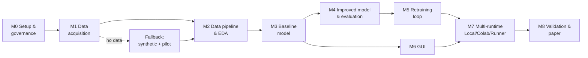
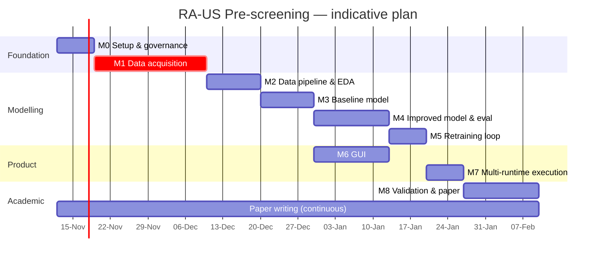

# 01 — Roadmap

Every milestone (M) closes with a **logbook entry** (`docs/logbook/`) and a
**git tag** (`m0`, `m1`, ...). Every task (T) that produces a finding, a blocker
or a result also gets a logbook entry. Durations assume ~10 h/week for 3 people;
adjust after M0.

## 1. Milestone flow

## 2. Timeline (indicative)

## 3. Milestones, objectives and tasks

### M0 — Setup & governance
**Objective:** reproducible repo, rules enforced, team aligned.
- T0.1 Create branch `PIA_devl`, docs skeleton, logbook. ✅
- T0.2 Install commit-msg hook (`git config core.hooksPath .githooks`) on every clone.
- T0.3 Answer open questions in `00_feasibility.md §6`; log decisions. ✅
- T0.4 Choose architecture option → **Option B** (ADR-001). ✅
- T0.5 Create `pyproject.toml`, project layout, manifest + patient-level split. ✅
- T0.6 Assign work packages to the 3 contributors.
**Exit criteria:** hook works, option chosen, env installs from scratch in < 10 min.

### M1 — Data acquisition (CRITICAL PATH)
**Objective:** ≥ 300 labelled images (target ≥ 1 000) from ≥ 50 patients.
- T1.1 Contact rheumatology service; draft data-sharing agreement.
- T1.2 Submit ethics-committee protocol (anonymisation, consent, storage).
- T1.3 Define acquisition protocol: joints, probe frequency (≥ 12 MHz), views, GS+PD.
- T1.4 Define labelling guide (EULAR-OMERACT 0–3 GS, 0–3 PD, combined).
- T1.5 Set up labelling tool (Label Studio / CVAT) and double-rate ≥ 20 % of images.
- T1.6 Request datasets from authors of related work (log responses).
- T1.7 Synthetic MCP/wrist generator with GS/PD grades 0–3 (stage S2). ✅
- T1.8 Download selected public MSK US datasets (stage S1); log licences.
**Exit criteria:** S1+S2 datasets ready now; clinical dataset v0 (S3) whenever the hospital delivers.

### M2 — Data pipeline & EDA
- T2.1 De-identification script: strip DICOM tags, crop burned-in text/UI.
- T2.2 Patient-level train/val/test split (no patient in two splits!).
- T2.3 Preprocessing: ROI crop, resize, intensity normalisation; PD channel handling.
- T2.4 EDA notebook: class balance, per-device distribution, image quality.
- T2.5 Dataset versioning (DVC or hashed manifests).

### M3 — Baseline model
- T3.1 Config-driven training script (`configs/*.yaml`). ✅
- T3.2 Baseline: ImageNet-pretrained EfficientNet-B0 / ConvNeXt-T, two inputs (GS + PD), 4-class head; fits 8 GB VRAM with AMP. ✅ (S2: combined QWK 0.908)
- T3.3 Metrics: accuracy, balanced acc, sensitivity, specificity, AUC, quadratic weighted kappa. ✅
- T3.4 Experiment tracking (MLflow local or W&B free tier). Pending — history.csv + model card for now.
- T3.5 Model card v0. ✅ (`model_card.json` per run)

### M4 — Improved model & evaluation
- T4.1 4-class grading, class-imbalance handling (weighted loss / focal loss).
- T4.2 Augmentations realistic for US (speckle noise, gain, depth, flips).
- T4.3 Compare backbones (CNN vs ViT/US foundation model); ablations.
- T4.4 Explainability: Grad-CAM overlays for the GUI and the paper. ✅ (exact CAM in ONNX graph)
- T4.5 Calibration (temperature scaling) and confidence thresholds for "refer to specialist". Temperature scaling ✅; thresholds pending
- T4.6 k-fold cross-validation at patient level; 95 % CIs (bootstrap). CIs ✅, k-fold pending.

### M5 — Retraining loop
- T5.1 `data/incoming/` drop-zone + validation of new labelled entries. ✅
- T5.2 `retrain` command: merges data, fine-tunes from last checkpoint, evaluates on the **frozen** test set. ✅
- T5.3 Promotion rule: new model replaces current only if test metrics do not degrade. ✅ (paired patient-level bootstrap)
- T5.4 Model registry (`models/registry.json`: version, data hash, metrics, date). ✅

### M6 — GUI for non-technical users
- T6.1 Wireframe: load image → result (grade, confidence, heat-map) → export PDF report. Partial ✅ (no PDF, no heat-map yet)
- T6.2 FastAPI inference service (ONNX Runtime) + PySide6 desktop client. ✅
- T6.5 PyInstaller installer for Windows; Docker Compose for research servers.
- T6.3 "Submit correction" button: clinician corrects the grade → feeds `data/incoming/`. ✅
- T6.4 Usability test with ≥ 3 non-technical users (SUS questionnaire → paper).

### M7 — Multi-runtime execution
- T7.1 Local: one-command install + run (CPU & GPU).
- T7.2 Colab: notebook that clones repo, mounts Drive data, trains, saves to Drive (see `03_colab_and_runners.md`).
- T7.3 Self-hosted GitHub runner: manual-dispatch training workflow.
- T7.4 Same config produces equivalent results in all three (log differences).

### M8 — Validation & paper
- T8.1 Final evaluation on held-out test set; compare with literature table.
- T8.2 Reader study (optional): model vs non-expert vs expert.
- T8.3 Write paper (`docs/paper/`), figures generated by scripts.
- T8.4 Tag release `v1.0`, freeze environment and data manifest.

## 4. Risk register

| Risk | P | Impact | Mitigation |
|---|---|---|---|
| No clinical data | High | Critical | Staged S0–S2 base model; retraining loop ready for hospital data. |
| Synthetic-to-real gap | High | High | S1 real-US pre-training; report synthetic results only as pipeline checks. |
| Ethics approval delay | Med | High | Submit in week 1; work on synthetic data meanwhile. |
| Data leakage (same patient in train/test) | Med | High | Patient-level split enforced in code + test. |
| Device/domain shift | High | Med | Log device per image; report per-device metrics. |
| Colab quota/cost | Med | Low | Free tier only, no paid units, checkpoints to Drive. |
| Patient data pushed to GitHub | Low | Critical | `.gitignore`, pre-commit check, data outside repo. |
| Commit attribution breaks grading | Low | Critical | `commit-msg` hook rejects co-author trailers. |
