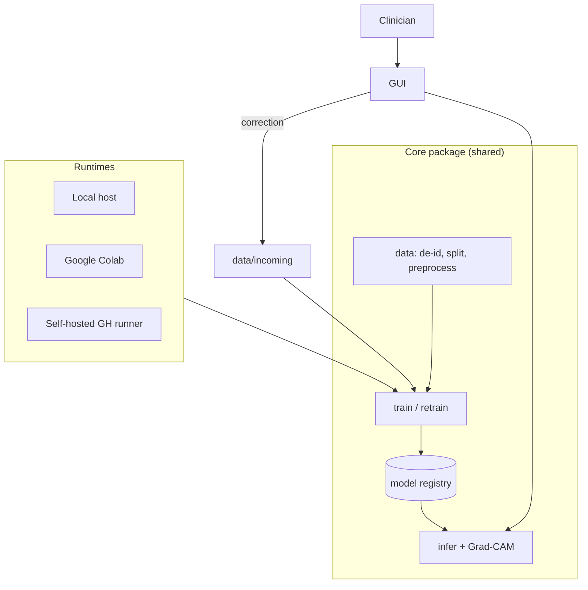

# 02 — Architecture & Stack Options

Both options share the same **core**: a Python package (`rausnet/`) with
`data`, `models`, `train`, `evaluate`, `retrain`, `infer` modules driven by YAML
configs. The options differ in GUI, serving and MLOps weight.



---

## Option A — "Lean Python" (recommended for a 3-person academic project)

| Layer | Choice |
|---|---|
| Language | Python 3.11 |
| DL framework | PyTorch 2.x + `timm` (pretrained backbones) |
| Training loop | PyTorch Lightning (or plain loop) |
| Config | Hydra / plain YAML |
| Tracking | MLflow (local `mlruns/`) |
| Data versioning | Hashed `manifest.csv` (optionally DVC with Google Drive remote) |
| Explainability | `pytorch-grad-cam` |
| GUI | **Gradio** web UI (runs locally in browser; can share link from Colab) |
| Packaging | `pip install -e .`, optional Docker |
| CI | GitHub Actions: lint + unit tests on GitHub-hosted; training on self-hosted runner (`workflow_dispatch`) |

**Pros:** fastest to build, one language, same GUI works locally and in Colab,
huge community. **Cons:** Gradio UI is less polished; requires Python installed
(mitigated with a launcher script / Docker).

## Option B — "Product-grade, decoupled"

| Layer | Choice |
|---|---|
| DL framework | PyTorch → export to **ONNX** for inference |
| Inference API | **FastAPI** + ONNX Runtime (CPU-friendly) |
| GUI | **Desktop app** (PySide6/Qt) *or* React web front-end calling the API |
| Packaging | Docker Compose (api + ui), PyInstaller for desktop `.exe` |
| Tracking / registry | MLflow server + model registry |
| Data versioning | DVC |
| Labelling | Label Studio integrated with `data/incoming` |
| CI/CD | Actions: build images, run tests, train on self-hosted runner, publish model artefact |

**Pros:** clinic-friendly installer, inference without GPU or PyTorch,
clean separation (good for a "system architecture" figure in the paper).
**Cons:** 2–3× more engineering work; more points of failure.

## Option C (variant) — "Notebook-first / low-code"

Colab notebooks + `fastai` + Streamlit. Very fast prototype, but weak
reproducibility, harder atomic commits on `.ipynb`, and retraining is less
robust. Useful only for the M3 spike.

## Comparison

| Criterion | A | B | C |
|---|---|---|---|
| Time to MVP | ★★★ | ★ | ★★★ |
| Non-technical UX | ★★ | ★★★ | ★★ |
| Retraining robustness | ★★★ | ★★★ | ★ |
| Runs Local/Colab/Runner | ★★★ | ★★ (Colab only for training) | ★★ |
| Paper "engineering" value | ★★ | ★★★ | ★ |
| Risk for 3 students | Low | High | Low |

**Recommendation:** start with **A**; design `infer` so that an **ONNX export**
is possible, allowing an upgrade path to **B** (FastAPI/desktop) in M6/M7 if time allows.

## Proposed repository layout (Option A)

```
.githooks/            commit-msg rules
configs/              train/*.yaml, data/*.yaml
docs/                 feasibility, roadmap, architecture, logbook, paper
notebooks/            colab_train.ipynb, eda.ipynb (outputs stripped)
rausnet/              core package
  data/  models/  train.py  retrain.py  evaluate.py  infer.py
app/                  gradio_app.py
scripts/              deidentify.py, make_manifest.py, export_onnx.py
tests/                unit tests (split leakage, preprocessing, inference)
.github/workflows/    ci.yml, train-self-hosted.yml
data/  models/  mlruns/   ← git-ignored, never committed
```
